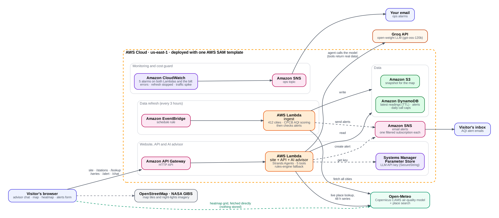

# India Air Advisor

An AI advisor and live map that tell anyone in India whether the air is safe, on the official CPCB AQI scale.
Built for the WeMakeDevs x AWS **Environmental Hacks** hackathon (Air track). Fully serverless on AWS.

- **AI advisor** - ask "Should I go out today?", "Best time to run?", "Compare Delhi and Mumbai". A Strands Agents
  agent calls five tools (current air, forecast, best windows, compare places, create alert); every number comes from data.
  A rules engine answers if the model is unreachable.
- **Map and dashboard** - 412 cities coloured by AQI or one pollutant (PM2.5, PM10, NO2, SO2, O3, CO, dust, UV);
  click anywhere in India for every pollutant, the CPCB 24-hour average and a past/next 48-hour chart.
- **Heatmap** - a continuous colour field; the visitor's browser fetches ~360 grid points straight from Open-Meteo (nothing stored).
- **Email alerts** - above / below an AQI you choose, or a clean-air window, through Amazon SNS.
- **Cost and health guards** - daily caps in code and five CloudWatch alarms.

Numbers are estimates from the Copernicus CAMS model via Open-Meteo (about 45 km resolution), not sensor readings.

## Architecture



EventBridge (every 3 h) -> ingest Lambda -> DynamoDB + S3. API Gateway -> API Lambda (website, `/stations`, `/lookup`,
`/series`, `/alert`, `/chat`). SNS for alerts, SSM Parameter Store for the LLM key, CloudWatch alarms for errors and cost.

## Deploy

Needs the AWS SAM CLI and Python 3.14 (or set `PythonRuntime` to 3.12/3.13).

```
# one-time: store your LLM key (OpenAI-compatible provider, for example Groq)
aws ssm put-parameter --name /air-advisor/llm-key --type SecureString --value "<your key>"

sam build && sam deploy --guided \
  --parameter-overrides LlmBaseUrl=https://api.groq.com/openai/v1 LlmModel=openai/gpt-oss-120b OpsEmail=you@example.com
```

Without `LlmBaseUrl` the advisor uses the built-in rules engine. To use Amazon Bedrock instead, set `BedrockModelId`.
After the first deploy, invoke the ingest function once so the map has data. The app URL is in the stack outputs.

## Tests

```
PYTHONPATH=src python tests/test_all.py   # also test_api, test_client, test_advisor, test_fuzzy, test_heat
```

## Data and credits

Open-Meteo (CC BY 4.0, free tier is non-commercial), Copernicus CAMS, GeoNames city list (CC BY 4.0), OpenStreetMap, NASA GIBS.
General information, not medical advice.
